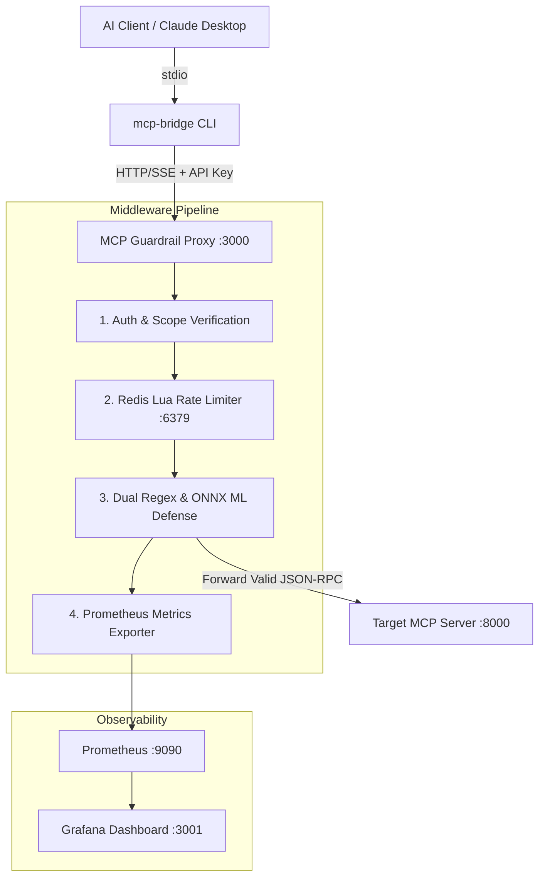

# 🛡️ MCP-Guardrail Proxy

> An enterprise-grade, lightweight security & rate-limiting reverse proxy for Model Context Protocol (MCP) tool servers.


## 🌟 Key Features
- **OAuth 2.1 / API Key Verification:** Granular tool-level permission scopes per identity tier.
- **Atomic Distributed Rate-Limiting:** Redis Lua-backed Token Bucket algorithm tuned for LLM burst traffic patterns.
- **Dual Defense Engine:** Regex shell injection detection + local ONNX ML prompt injection scoring.
- **Stdio-to-HTTP Transport Bridge:** Connect Claude Desktop securely to remote MCP server infrastructures.
- **Live Observability:** Native `/metrics` endpoint with bundled Prometheus and Grafana dashboards.
- **Zero-Downtime Hot Reloading:** Live `guardrail.yml` updates without proxy restarts.

## 📐 Architecture Flow




## 🚀 Quick Start

### 1. Launch Stack via Docker
```bash
docker compose up --build -d
````

### 2. Run Automated Verification Tests


```bash
npm test
```

### 3. Connect via Stdio Transport Bridge (Claude Desktop)

Add to your `claude_desktop_config.json`:


```json
{
  "mcpServers": {
    "secure-mcp-proxy": {
      "command": "npx",
      "args": ["tsx", "/path/to/mcp-guardrail/src/cli/bridge.ts"],
      "env": {
        "MCP_PROXY_URL": "http://localhost:3000/",
        "MCP_API_KEY": "key_enterprise_999"
      }
    }
  }
}
```
